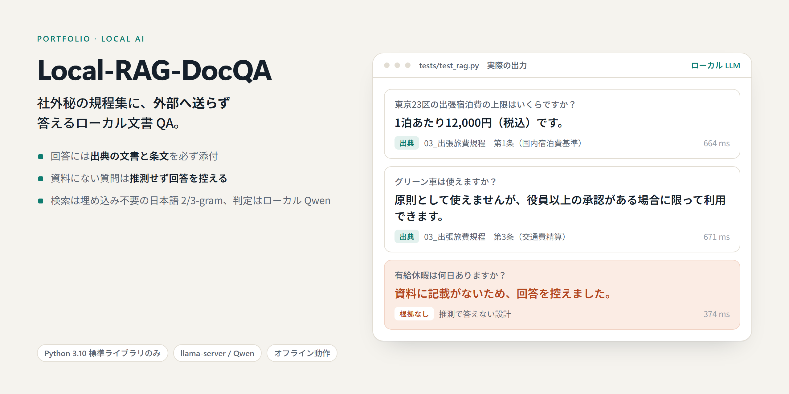

<p align="center"></p>

# Local-RAG-DocQA

**Answers questions about your own documents (TXT, Markdown, Word, PDF) with a local LLM, cites the file, article and page, and refuses when the documents do not say. Nothing leaves the machine.**

[](LICENSE)


[日本語](README_JA.md)

## Use it

```bash
pip install -r requirements.txt                       # only pypdf, for PDFs; the rest is standard library
python ask.py samples/formats "在宅勤務手当はいくらですか？"
python ask.py 社内規程/                                # interactive: one question per line
python ask.py 社内規程/ "…" --json                     # machine-readable
python ask.py 社内規程/ "…" --offline                  # no LLM: return the matching passage verbatim
```

```text
在宅勤務手当は月額3,000円です。
  出典: [06_リモートワーク規程] 06_リモートワーク規程.pdf p.2  （llm, スコア 0.251, 587 ms）
  該当: 第3条(在宅勤務手当)
```

It needs any OpenAI-compatible server on your machine for the answers: llama-server (default
`http://127.0.0.1:8080/v1`), or Ollama with `--endpoint http://127.0.0.1:11434/v1 --model qwen3:8b`, or vLLM / LM Studio.

## How it works

```text
documents ──► split at 第N条 / numbered / ■ headings, 240-char chunks with the heading repeated
          ──► index: IDF-weighted character 2/3-grams (Japanese needs no tokenizer, NFKC-normalised)
question  ──► top 3 passages ──(score < 0.03)──► refuse
          ──► local LLM, temperature 0: answer only from the numbered passages and cite one,
              or reply 「該当なし」 ──► refuse
          ──► answer + file + page + article excerpt
```

* **Why the LLM decides relevance.** No lexical score separates in-scope from out-of-scope questions: in the
  tests, "有給休暇は何日ありますか？" (not in the documents) scores higher than real questions. The model reads the
  passages and refuses; the test suite checks that it does.
* **Without an LLM** (`--offline`, or none reachable) the best passage is returned verbatim when its score is at
  least 0.10, otherwise the engine refuses.
* **PDF**: text-layer PDFs only (scanned PDFs need OCR first). Kangxi-radical look-alikes that PDF fonts often
  produce (⽉ for 月) are normalised. Answers cite the page.
* **Word**: `.docx` is read with the standard library (zip + XML), no extra package.

## Use from Python

```python
from rag_engine import LocalRagEngine         # src/ on sys.path
engine = LocalRagEngine(endpoint="http://127.0.0.1:8080/v1")
engine.load_directory("社内規程/")
a = engine.query("返品は何日以内ですか？")
print(a.answer, a.source_title, a.page, a.grounded)
```

## Tests

```bash
python tests/test_rag.py
```
Six questions on four sample policies (answers, sources and one refusal), an out-of-scope question only
the LLM can reject (run when an LLM is listening on :8080), the same questions offline, Word and PDF with page
numbers, and the command line.

Measured with Qwen on llama-server (RTX 5070 Ti): 0.3–0.7 s per question.

## License

[MIT](LICENSE)
