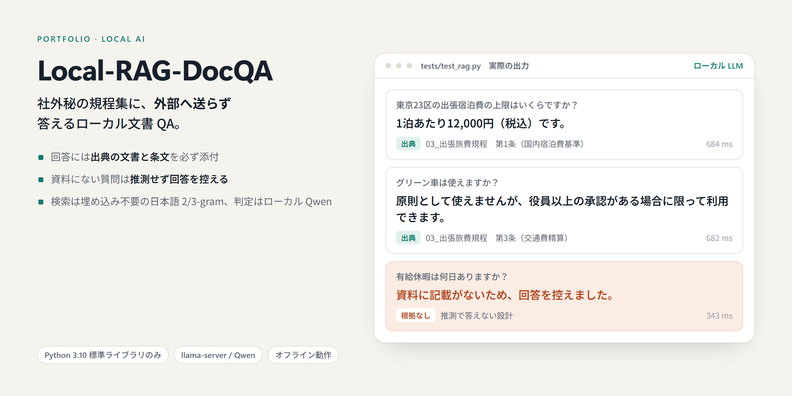

<p align="center"></p>

# Local-RAG-DocQA: ローカル文書検索＆高精度質問応答システム

<div align="center">

**外部API送信ゼロ · 社外秘資料対応 · 出典明記型ローカルRAG**  
*ローカルLLM（Qwen） · 依存ライブラリなしの日本語 n-gram 検索 · ハルシネーション（嘘の回答）防止*

</div>

---

## 1. 開発の背景と特徴

社内規定、雇用契約、NDA締結資料、業務マニュアルなどの機密文書を扱う際、一般的なクラウドAIサービス（ChatGPTや外部API）にデータを送信することは情報漏洩リスクを伴います。

本システムは、**すべてのデータ処理と推論を社内PC/オンプレミス環境内で完結**させる文書検索・質問応答（RAG）エンジンです。

* **完全ローカル完結**: 外部ネットワークへ通信を行わず、社内機密情報を安全に処理。
* **出典・根拠の明示**: 回答だけでなく、根拠となった文書名・該当段落・抜粋テキストを必ずセットで出力。
* **軽量な検索**: 埋め込みモデル不要。文字 2/3-gram の IDF 重み付けで上位3件を取り出し、ローカルLLMが番号付き資料だけを根拠に回答・出典番号を返します。
* **回答拒否（ハルシネーション防止）ゲート**: 資料内に根拠がない質問に対しては推測を行わず、「資料からは確認できません」と明答する安全設計。

---

## 2. 動作確認・テスト手順

```bash
# テストスイートの実行
python tests/test_rag.py
```

実行結果の例（llama-server 上の Qwen）：
```text
[llm] 返品は何日以内ですか？
  -> 商品受領日から14日以内です。
  source=[01_返品ポリシー] 01_返品ポリシー.txt score=0.132 365.34ms
[refused] 有給休暇は何日ありますか？
  -> 社内規定および提供資料からは該当する情報を確認できませんでした。（推測防止のため回答を控えます）
  source=— score=0.149 274.33ms
```

LLM に接続できない場合は、スコア 0.10 以上の最上位の段落をそのまま返し（extractive モード）、それ未満は回答を控えます。

---

## 3. ライセンス
MIT License
